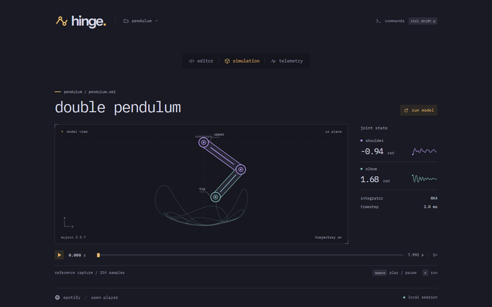

# hinge.

A local robotics IDE with an embedded LazyVim editor, a MuJoCo model inspector, and telemetry you can take into AdvantageScope or convert to MCAP. The interface uses a quiet Tokyo Night palette, self-hosted type, and a searchable command menu.



## Start a session

Install Node.js 24.12 or newer and Git. Run these commands from the directory containing this README.

```sh
npm ci
npm run build
npm start
```

Open **http://127.0.0.1:4317**. The default folder is `examples/pendulum`. It opens with an eight-second reference capture computed from the included MJCF model. Press **Space** to replay, drag the timeline to inspect a sample, or press **Ctrl+Shift+P** to find a command. The commands button works with a mouse.

**Open your own project** by passing its folder or a parent containing several projects. Quote paths with spaces.

```sh
npm start -- --root "/absolute/path/to/robot-projects" --port 4317
```

Click the folder name in the header to browse beneath that root. Choose **open this folder**. The model selector lists XML files in the selected directory. For a nested model, open its containing folder. **Editor** lists visible files and the current Git branch and change count. The editor inherits the selected working directory.

## Enable native tools

Run `npm run doctor` to check Git, Neovim, the terminal adapter, LazyVim, MuJoCo, MCAP, and lazygit. The web interface and saved capture work independently of the optional tools below.

**Simulation and conversion.** The tested interpreter is CPython 3.12. The MuJoCo and MCAP dependencies have separate requirements files. Install both for the full workflow. With uv installed:

```sh
uv venv --python 3.12 .venv
uv pip install --python .venv -r simulator/requirements.txt -r simulator/mcap-requirements.txt
```

Alternatively, on Windows PowerShell:

```powershell
py -3.12 -m venv .venv
.\.venv\Scripts\python.exe -m pip install -r simulator/requirements.txt -r simulator/mcap-requirements.txt
```

On macOS or Linux:

```sh
python3.12 -m venv .venv
.venv/bin/python -m pip install -r simulator/requirements.txt -r simulator/mcap-requirements.txt
```

Set `HINGE_PYTHON` to an absolute interpreter path if you use another environment. Run **run model** or press **R** to read the saved XML and generate a new capture. Switch to **telemetry** for synchronized position and velocity plots.

**Editing.** Install Neovim with LuaJIT. This profile and its plugin revisions were tested with Neovim 0.12.6. Install Git and ripgrep on PATH. On Windows, Neovim is available via `winget install Neovim.Neovim`. Alternatively, set `HINGE_NVIM` to an absolute executable path. Git and Neovim downloads can run without an account. Then run:

```sh
npm run setup:editor
```

Setup fetches pinned LazyVim and lazy.nvim revisions from GitHub and checks every plugin against `editor/lazy-lock.json`. Hinge keeps the plugin data, cache, state, and configuration under `.hinge/editor`. The profile uses Tokyo Night, disables periodic plugin checks, and leaves additional parsers and language servers for you to select. Customize it in `editor/init.lua`. Additional compiled Tree-sitter parsers can require the Tree-sitter CLI and a C compiler.

Choose **editor → open LazyVim**, or click a filename. `:w` writes to disk. Use `:HingeFiles` to find files and `:HingeGit` to inspect changed files. Install lazygit for a full stage, commit, fetch, and push interface inside LazyVim with **Space g g**. Use `:wqa` to save and exit before switching folders. Switching views retains the editor. Closing the browser connection ends its process.

The embedded terminal uses the optional native package `node-pty`. If its prebuilt binary is unavailable, install the build tools required by node-gyp for your OS and run `npm rebuild node-pty`. On Windows the terminal uses ConPTY. A locally installed JetBrainsMono or CaskaydiaCove Nerd Font Mono supplies additional terminal icons.

**Git access.** Open an existing clone, or clone a remote with your normal Git tools first. Local edits, status, and commits require no hosting account. Private clones and pushes use your existing Git credential manager or SSH agent. Configure your Git author name and email before committing. Hinge has no service account or token field.

**Music.** Click **spotify / open player** at the bottom and paste an `https://open.spotify.com` track, playlist, album, or episode link. Opening loads Spotify's official player and remembers the link in this browser. Closing removes the iframe. Spotify controls login, preview availability, and playback. Hinge needs no Spotify developer credentials.

## Telemetry and the MCAP terminal command

1. Run your model, switch to **telemetry**, and click **export csv**. The browser downloads a numeric AdvantageScope CSV table. The first column, `Timestamp`, is simulation time in seconds. Each joint has `/Sim/qpos/N` and `/Sim/qvel/N` columns, where N is the zero-based MuJoCo joint index. Hinge and the XML give each index its joint name. Hinge joints use radians, slide joints use metres, and velocities use the corresponding unit per second.
2. In AdvantageScope use **File → Open Log(s)** and select the CSV. Drag a signal into a line graph.
3. Convert the exported CSV from a terminal:

```sh
npm run mcap -- "/path/to/pendulum.csv"
```

This writes `/path/to/pendulum.mcap` and prints its absolute path. From a robot project's terminal you can run `node "/path/to/hinge/scripts/mcap.mjs" "./pendulum.csv"`. Both commands use the same converter. To replace an existing result after verification:

```sh
npm run mcap -- "/path/to/pendulum.csv" --force
```

Each input row becomes one JSON Schema message on `/hinge/telemetry`. The converter preserves the numeric fields and maps each decimal timestamp to integer nanoseconds for both MCAP log time and publish time, measured from simulation time zero. It accepts nondecreasing times (including duplicates) with up to nanosecond precision, checks finite numeric values, and reads back every row before publishing the file. An invalid input leaves a previous output intact. Use the MCAP in a compatible viewer such as Foxglove. AdvantageScope interoperability here uses the CSV.

## Model and execution boundaries

The inspector draws an XZ projection of body origins and sites. Each stroke connects a child to its parent. The trajectory tracks the last node in model order. The native worker runs `mj_step` headlessly for up to eight simulated seconds, starting at keyframe zero when present. A run is computed on demand and replayed from samples. For the example, a 2 ms physics step produces samples every 24 ms and includes both the initial state and the sample at 7.992 s.

The MVP accepts UTF-8, single-file MJCF with hinge or slide joints. It supports bodies, primitive geoms, inertials, sites, keyframes, and simple motor, position, or velocity actuators. The exact element and attribute allowlist lives in `simulator/run.py`. Includes, external meshes or textures, plugins, and replicated geometry are outside this runner's scope. Limits include 64 KiB of XML, 12 coordinates, 32 bodies plus sites, 120 elements, one simulation at a time, and a 20-second process timeout. The model must have a timestep between 0.5 and 20 ms. There is no CAD mating pipeline or live NT4 stream in this MVP.

Run this on a trusted local workstation. Express binds to IPv4 loopback and checks the request host and browser origin. API calls and editor upgrades require a per-process token. Folder and model paths are resolved against the configured root, including resolved link targets. The server invokes fixed executable paths with argument arrays. The native editor can edit files, invoke shells and Git, and run tools with your OS permissions. Open trusted projects. The folder boundary constrains the web API and does not sandbox Neovim. Keep the server on loopback and avoid forwarding its port.

## Development and verification

| Command | Purpose |
| --- | --- |
| `npm run dev` | Local Express and Vite development server with hot reload. Supports the same root and port options. |
| `npm run check` | Type-check the TypeScript client, server, and tests. |
| `npm test` | Check path confinement, Git status, origin and token checks, WebSocket authorization, and CSV data. Requires Git. |
| `npm run test:sim` | Compare a real MuJoCo run with the saved capture and exercise rejected MJCF inputs. |
| `npm run test:mcap` | Test nanosecond timestamps, malformed input, and preservation of an existing MCAP on failure. |
| `npm run test:native` | Exercise a real HTTP simulation, concurrent-run rejection, CSV-to-MCAP CLI round trip, and a disk write through the native LazyVim terminal. Requires all three adapters. |

The client uses TypeScript, Vite, and Tailwind CSS. It draws the instrument and traces on canvas, loads xterm only when opening the editor, and schedules animation frames only during playback. Git status is queried on project load and after editor exit. Simulation and terminal processes start on demand. In the verified production build, Vite reported 7.60 kB gzip for the main JavaScript and a separate 83.88 kB gzip for the editor JavaScript. Font, style, HTML, and capture data are additional payloads.

The Windows build was exercised with Node 24, CPython 3.12, MuJoCo 3.3.7, Neovim 0.12.6, and LazyVim 16.0.1. Browser checks covered folder selection, the keyboard palette, model runs, playback, telemetry download, native editor saves, and Git. The upstream AdvantageScope CSV decoder read all four signals from the example. Desktop application playback in AdvantageScope, authenticated Spotify playback, and macOS/Linux runtime behavior were not exercised in this session.

## License and upstream adapters

Original Hinge code and the example model are MIT-licensed. Integration descriptions, upstream licenses, and links are in [THIRD_PARTY.md](THIRD_PARTY.md). Font and browser dependency notices are included under `client/public/licenses` and in the production build.

